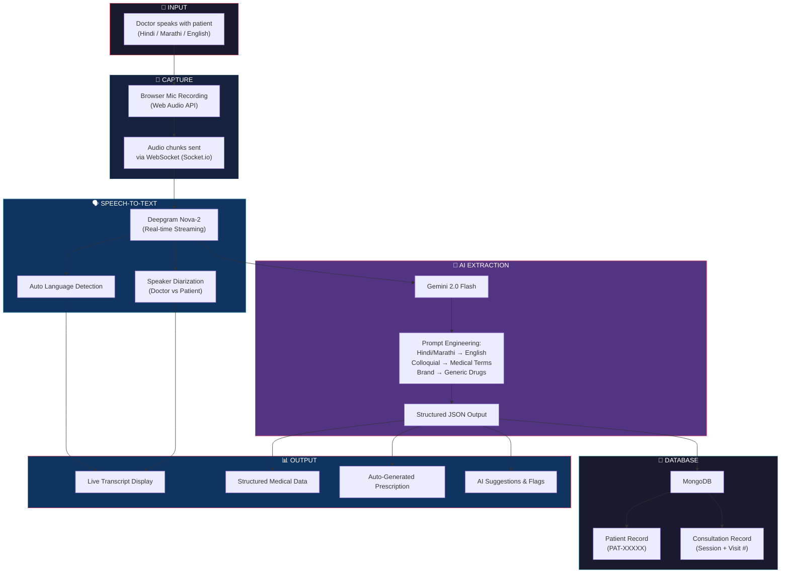
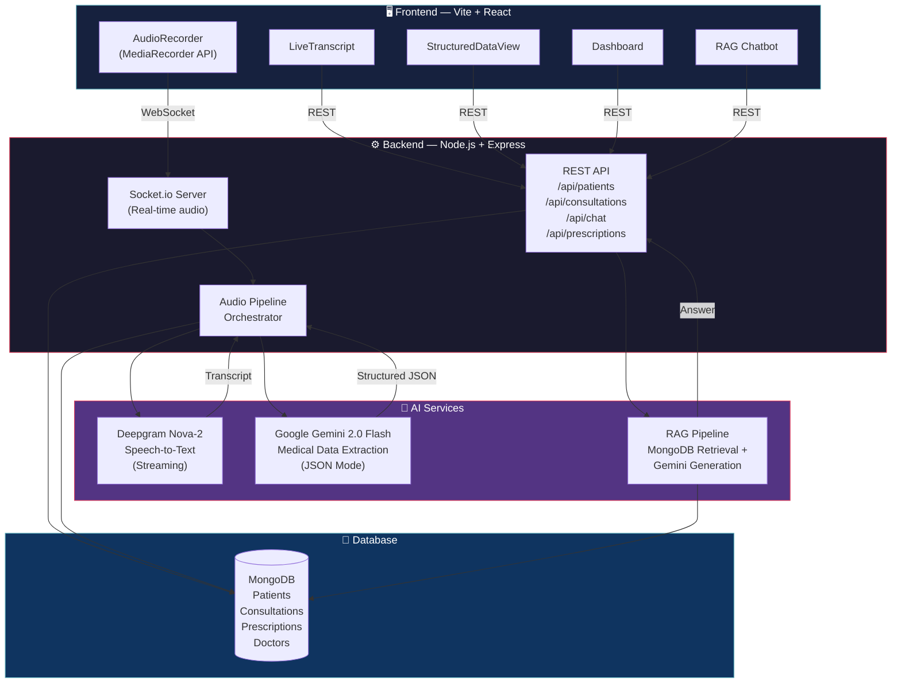
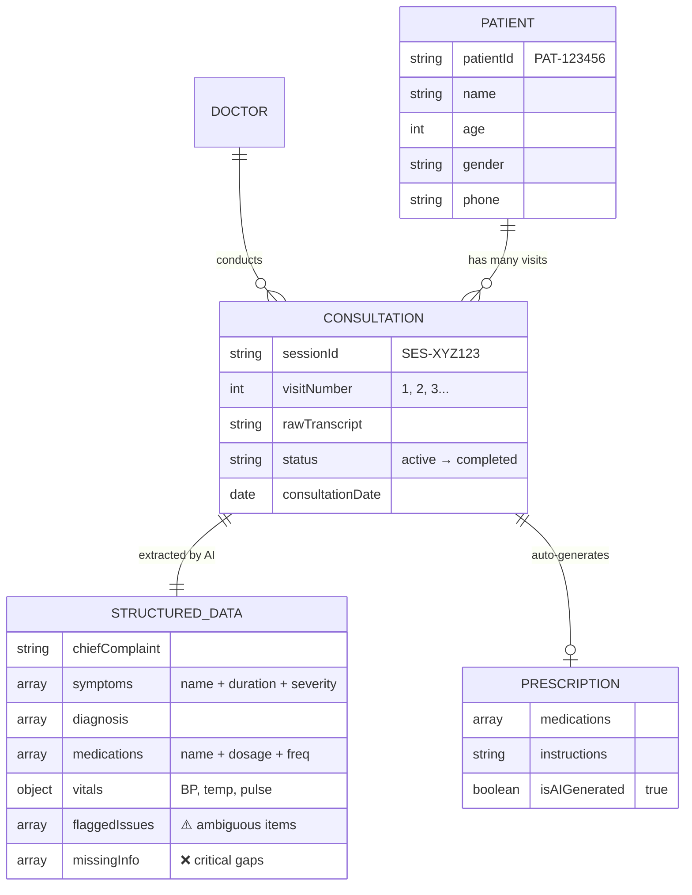
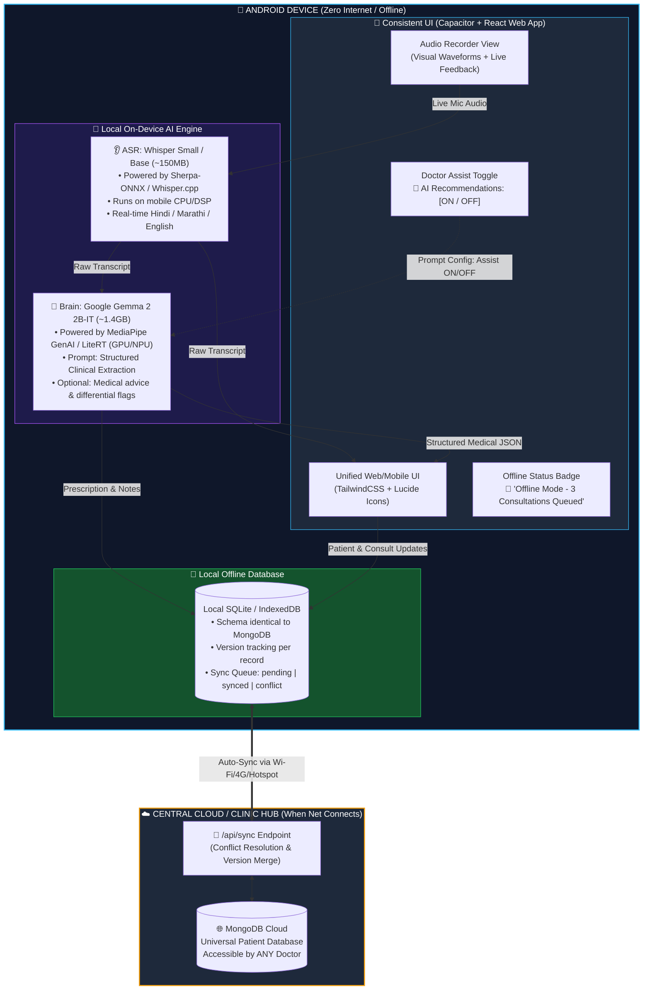
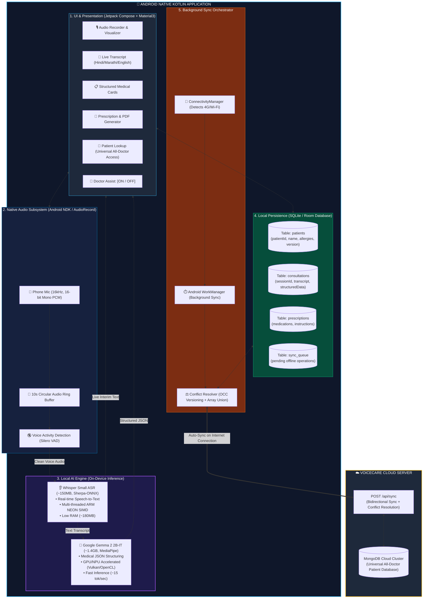

# 🏥 VoiceCare — System Flow Diagrams
> Share these with your team to understand the full pipeline.

---

## 1. End-to-End MVP Flow (The Big Picture)

---

## 2. Real-Time Audio Pipeline (WebSocket)

```mermaid
sequenceDiagram
    participant 👨‍⚕️ as Doctor + Patient
    participant 🖥️ as Frontend
    participant 🔌 as Socket.io
    participant 🎤 as Deepgram ASR
    participant 🧠 as Gemini LLM
    participant 💾 as MongoDB

    👨‍⚕️->>🖥️: Start consultation
    🖥️->>🔌: audio:start {patientId}
    🔌->>💾: Create consultation (status: active)
    🔌->>🎤: Open live stream
    🔌-->>🖥️: audio:ready {sessionId}

    rect rgb(30, 50, 80)
        Note over 👨‍⚕️,🎤: Live Recording Loop
        👨‍⚕️->>🖥️: Speaking...
        🖥️->>🔌: audio:chunk (every 250ms)
        🔌->>🎤: Forward audio buffer
        🎤-->>🔌: Interim transcript
        🔌-->>🖥️: transcript:interim {text, lang}
        🎤-->>🔌: Final transcript segment
        🔌-->>🖥️: transcript:final {text, lang}
    end

    👨‍⚕️->>🖥️: Stop recording
    🖥️->>🔌: audio:stop
    🔌->>🎤: Close stream

    rect rgb(60, 30, 80)
        Note over 🔌,💾: AI Extraction Pipeline
        🔌-->>🖥️: extraction:progress (30%)
        🔌->>🧠: Full transcript + languages
        🧠-->>🔌: Structured JSON
        🔌-->>🖥️: extraction:progress (70%)
        🔌->>🧠: Generate doctor suggestions
        🧠-->>🔌: Diagnoses + Warnings
        🔌-->>🖥️: extraction:progress (90%)
        🔌->>💾: Save complete consultation
    end

    🔌-->>🖥️: extraction:complete {structuredData, suggestions}
    🖥️-->>👨‍⚕️: Display results
```

---

## 3. What the LLM Actually Does

```mermaid
flowchart LR
    subgraph IN["Raw Transcript"]
        T1["'Doctor: Kya problem hai?<br/>Patient: Mujhe 3 din se<br/>bukhar hai aur sir mein<br/>bahut dard ho raha hai.<br/>Doctor: Temperature check<br/>karo... 101 hai. Crocin<br/>500mg do din mein<br/>teen baar, 5 din ke liye'"]
    end

    subgraph PROCESS["Gemini 2.0 Flash"]
        P1["🔤 Language Detection<br/>Hindi detected"]
        P2["🏥 Medical Term Mapping<br/>bukhar → Fever<br/>sir dard → Headache"]
        P3["💊 Drug Normalization<br/>Crocin → Paracetamol"]
        P4["⚠️ Missing Info Check"]
    end

    subgraph OUT["Structured JSON"]
        O1["✅ Chief Complaint:<br/>'Fever with headache'"]
        O2["✅ Symptoms:<br/>- Fever (3 days, moderate)<br/>- Headache (3 days, severe)"]
        O3["✅ Vitals:<br/>Temp: 101°F"]
        O4["✅ Medications:<br/>Paracetamol 500mg<br/>3x daily, 5 days"]
        O5["⚠️ Missing:<br/>- Allergy status<br/>- BP not recorded"]
    end

    IN --> PROCESS --> OUT

    style IN fill:#1a1a2e,color:#fff
    style PROCESS fill:#533483,color:#fff
    style OUT fill:#0f3460,color:#fff
```

---

## 4. Tech Stack Map

---

## 5. Database Relationships

---

## 6. Team Task Division

```mermaid
flowchart LR
    subgraph T1["👤 Person 1: Frontend"]
        A1["Audio Recorder Component"]
        A2["Live Transcript UI"]
        A3["Dashboard + Patient List"]
        A4["Structured Data Cards"]
    end

    subgraph T2["👤 Person 2: Backend + AI"]
        B1["Express Server + Socket.io"]
        B2["Deepgram ASR Integration"]
        B3["Gemini Prompt Engineering"]
        B4["MongoDB Models + Routes"]
    end

    subgraph T3["👤 Person 3: Features + Polish"]
        C1["RAG Chatbot"]
        C2["Doctor Assist Panel"]
        C3["Prescription Generation"]
        C4["UI Polish + Animations"]
    end

    T1 <-->|Socket.io + REST| T2
    T2 <-->|RAG + Assist APIs| T3
    T1 <-->|Chat + Assist UI| T3

    style T1 fill:#16213e,color:#fff,stroke:#53a8b6
    style T2 fill:#533483,color:#fff,stroke:#e94560
    style T3 fill:#0f3460,color:#fff,stroke:#e94560
```

---

## Quick Reference: API Endpoints

| Method | Endpoint | What it does |
|--------|----------|-------------|
| `POST` | `/api/patients` | Register new patient (shared across all doctors) |
| `GET` | `/api/patients?q=search` | Search patients across entire clinic/system |
| `GET` | `/api/patients/:id/history` | Full visit history across all attending doctors |
| `POST` | `/api/consultations` | Process audio/transcript → structured data |
| `GET` | `/api/consultations/:sessionId` | Get consultation result (any doctor) |
| `POST` | `/api/chat` | Ask AI about patient history (RAG) |
| `POST` | `/api/prescriptions` | Auto-generate prescription |
| `POST` | `/api/sync` | **2-Way Offline Sync**: Push changes + resolve conflicts + pull cloud updates |
| `POST` | `/api/sync/push` | Push offline records to cloud DB |
| `GET` | `/api/sync/pull?since=...` | Pull recent changes from other doctors |
| `WS` | `audio:start → audio:chunk → audio:stop` | Live recording pipeline |

---

## 7. 📱 Offline-First Rural Architecture (100% On-Device AI)
> Built specifically for villages, PHCs, and low-connectivity regions. **Zero internet required during consultation.**

---

## 8. 🔄 Offline-to-Cloud Sync & Conflict Resolution Pipeline
> Resolves conflicts when multiple doctors edit patients or consultations simultaneously while offline.

```mermaid
sequenceDiagram
    autonumber
    participant 📱 as Doctor A (Android Offline)
    participant 💻 as Doctor B (Web / Clinic)
    participant ⚙️ as Cloud Server (/api/sync)
    participant 🗄️ as MongoDB Cloud

    Note over 📱: Doctor A records in village without internet.<br/>Saved locally (version: 1, syncStatus: pending)
    
    Note over 💻: Doctor B updates patient address on Web.<br/>Saved to cloud (version: 2, updatedAt: 10:15 AM)
    
    📱->>📱: Internet connection restored (4G / Wi-Fi detected)
    
    rect rgb(30, 45, 75)
        Note over 📱,⚙️: Bidirectional Sync Phase (POST /api/sync)
        📱->>⚙️: Push Offline Changes { patients: [...], consultations: [...] }<br/>with lastSyncTimestamp = 10:00 AM
        
        Note over ⚙️: Conflict Resolution Engine runs:<br/>1. Unique sessionId prevents consultation overwrite<br/>2. Allergies & Medical History: Non-destructive Set Union<br/>3. Demographics: Last-Write-Wins by timestamp<br/>4. Version incremented: version = 3
        
        ⚙️->>🗄️: Commit merged Patient & Consultation
        🗄️-->>⚙️: Merged state saved
        
        ⚙️->>🗄️: Fetch updates from other doctors since 10:00 AM
        🗄️-->>⚙️: Return Doctor B's updates
        
        ⚙️-->>📱: { success: true, pushed: [...], conflicts: [], serverUpdates: [...] }
        📱->>📱: Update local SQLite/IndexedDB to version 3 (syncStatus: synced)
    end
    
    Note over 📱,💻: Both devices are now 100% in sync with exact same medical history!
```

---

## 9. 🎨 Cross-Platform UI Consistency Strategy (Web & Native Kotlin)

To ensure **zero learning curve** for doctors switching between the Web dashboard and the Android mobile app:

1. **Shared Design Tokens & Color Palette (Jetpack Compose Material3):**
   - The Android app is written in **100% Native Kotlin using Jetpack Compose**.
   - Design tokens map directly from the web app: Outfit typography, Slate dark surfaces (`#0F172A`, `#1E293B`), Sky blue accent (`#0EA5E9`), Emerald status indicators (`#10B981`), and Indigo AI accents (`#6366F1`).
   - Transcription chat bubbles, medical summary cards, and prescription layouts match the web app pixel-for-pixel.

2. **Adaptive Responsive Layout:**
   - **Desktop Web:** Split-screen layout (Audio Recorder on Left, Live Structured Cards on Right).
   - **Android Native App:** Bottom Navigation + Tabbed screens (`[Dashboard]`, `[Consultation]`, `[History]`) optimized for single-handed doctor usage on smartphones and clinical tablets.

3. **Doctor Assist Toggle (Performance & Autonomy):**
   - A dedicated toggle on both Web and Mobile:
     - **OFF (Default):** Extracts only spoken facts, medications, vitals, and symptoms. Saves mobile battery and CPU execution time by 50%.
     - **ON:** Activates Gemma 2B's reasoning to suggest differential diagnoses, warning flags, and test recommendations.

---

## 10. 📱 Android App Internal Subsystems Diagram (Native Kotlin)

